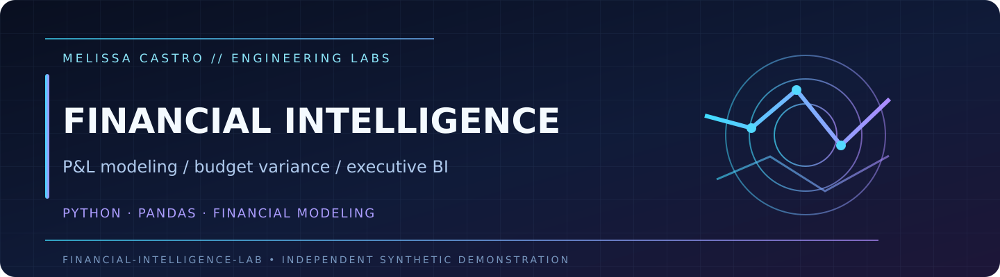
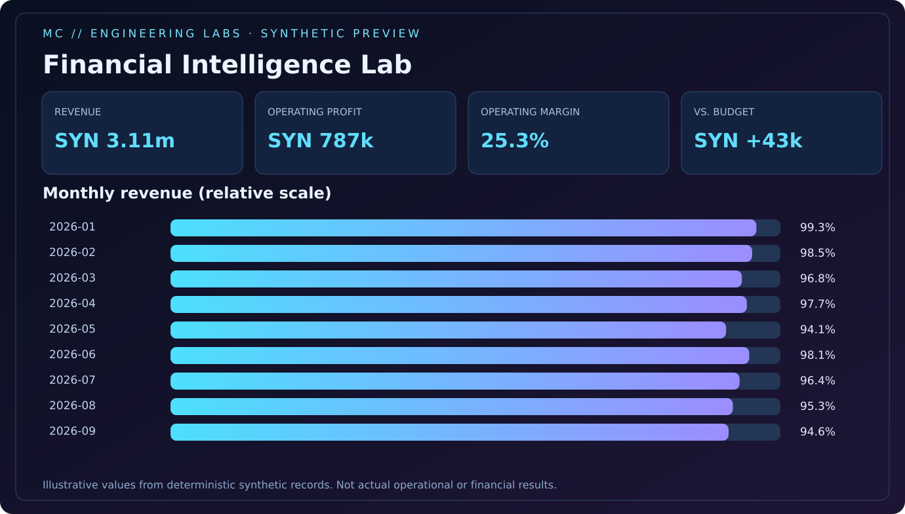

<p align="center"></p>
<p align="center"><a href="https://github.com/Dicureck/financial-intelligence-lab/actions/workflows/ci.yml"></a>   </p>

# Financial Intelligence Lab

A transparent, testable demonstration of **financial modeling, monthly performance analysis, operating-margin reporting, and budget vs. actual variance** using completely synthetic ledger data.

> All organizations, amounts, channels and transactions are fictional. The project is educational and does not claim access to a customer's financial data or constitute accounting/financial advice.

## Synthetic dashboard preview



The [standalone HTML sample](examples/synthetic-dashboard.html) uses illustrative values. Running the CLI will regenerate it.

## Run locally

```bash
python -m venv .venv
# Activate your environment first.
python -m pip install -e '.[dev]'
python -m pytest -q
python -m financial_intelligence_lab demo --seed 2026 --out-dir build/demo
```

Open the **self-contained** `build/demo/dashboard.html` to explore the executive visualization. The same command exports the original transactions, budgets, monthly P&L and channel-level P&L to CSV; all are freshly generated from the provided random seed.

## What this project tests

- Gross profit and operating profit identities.
- Month/channel/account key coverage, duplicate-budget prevention and reconciliation.
- Revenue rollup conservation from transaction-level facts.
- Controlled actual-versus-budget variance calculations.
- Reproducibility with deterministic synthetic seeds.

## Engineering artifacts

| Artifact | Purpose |
|:--|:--|
| `src/financial_intelligence_lab/core.py` | Fictional ledger/budget generators and P&L calculations |
| `src/financial_intelligence_lab/report.py` | Offline executive report template |
| `tests/` | Accounting identities, integrity, and reproducibility |
| [Financial model](docs/financial-model.md) | Metric definitions and limitations |
| [Power BI blueprint](docs/power-bi-blueprint.md) | Dimensional modeling, DAX and suggested pages |
| [Engineering decisions](docs/decisions.md) | Tradeoffs, guardrails, and explicit exclusions |

## Model diagram

```text
Synthetic ledger (transaction-level facts) ──┐
                                             ├─ key validation ─ P&L ─ monthly / channel KPIs ─ dashboard
Synthetic budgets (month × channel × account) ┘
```

**Professional context:** original demonstration developed by Melissa Castro for a public engineering portfolio. All datasets and examples were created independently. No client code or financial records. MIT license.

## Explore the interactive portfolio dashboard

[**Open Financial Intelligence interactive demo →**](https://dicureck.github.io/?demo=finance#lab)

[Read the engineering case study →](https://github.com/Dicureck/Dicureck/blob/main/case-studies/finance.md)

The interactive portfolio view uses **its own independently generated, deterministic fictional sample**. It is an exploration companion—not the same dataset as this repository and not a claim of cross-project reconciliation. Filter records, inspect metrics and export synthetic CSV directly in your browser.

**Publication note:** native Power BI / Tableau integrations are methodology examples until runnable native artifacts and independent tool validation are published. See the [BI calculation examples](https://github.com/Dicureck/Dicureck/blob/main/knowledge-base/bi-examples.md).
